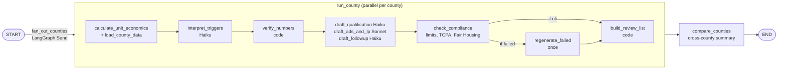

# county-campaign-builder

> 🇺🇸 EN | 🇧🇷 [PT-BR](README.pt-BR.md)

[](https://github.com/fgm9000/county-campaign-builder/actions/workflows/ci.yml)
[](https://github.com/fgm9000/county-campaign-builder/actions/workflows/codeql.yml)
[](https://fgm9000.github.io/county-campaign-builder/)
[](quality-baseline.json)
[](quality-baseline.json)
[](LICENSE)

**In a pay-per-lead real estate business, the product is a motivated-seller lead (a homeowner looking to sell), sold to real estate investors at a fixed bid — buying clicks in a county where cost per lead exceeds that bid loses money.** Before any spend, code compares counties side by side (benchmarked on Dallas, TX; Pinellas, FL; and Cook, IL — supporting any of the 3,222 U.S. counties): it computes each county's CPL range, max viable CPC, and a green, yellow, or red verdict against the bid, alongside U.S. Census ACS (2020–2024) and NOAA Storm Events (2020–2024) data on local housing and weather-driven financial pressures to guide media decisions. Only then does the pipeline generate each county's campaign: the LLM drafts copy focused on those real local pressures, and code checks every cited number and compliance rule. A person reviews flagged claims, offer terms, and assumptions before launch.

> Portfolio demo (POC), not a client product. The public playground uses pre-computed responses and illustrative CPC/CVR operator assumptions; live mode runs only with an access code.

**Try it in 30 seconds:** [fgm9000.github.io/county-campaign-builder](https://fgm9000.github.io/county-campaign-builder/).

---

## The 30-second rule

The opening screen leads with the **Perfect Pair** for revenue-driven paid acquisition — **persuasion grounded in real local pressures** plus **margin-protecting math** — backed by a transparent governance shield:

1. **Fact-Grounded Persuasion (Data-to-Copy Translation):**
   Verified U.S. Census housing stock pressures (median build year, long-term ownership >25 years, free-and-clear equity, vacancy) and NOAA severe weather history steer **angle-tagged Google RSA ads (5 headlines, 3 descriptions), LP hero copy, SMS, emails, and 5 intake qualification questions** per county. Instead of generic AI fluff or quoting dry statistics, copy converts motivated prospects by addressing concrete local financial and maintenance burdens.

2. **Multi-County Auction Math with Traffic Lights** (at a `$125.00` target lead bid):

   | County (FIPS) | CPC Range | Landing CVR | CPL Range | Max Viable CPC | Verdict |
   |---|---:|---:|---:|---:|---|
   | **Dallas County, TX** (`48113`) | `$2.00–$4.00` | `5.0%–10.0%` | `$20.00–$80.00` | `$6.25` | 🟢 **Green** — profitable across the full range |
   | **Pinellas County, FL** (`12103`) | `$4.50–$9.00` | `6.0%–10.0%` | `$45.00–$150.00` | `$7.50` | 🟡 **Yellow** — closes only in favorable conditions |
   | **Cook County, IL** (`17031`) | `$11.00–$15.00` | `5.0%–8.0%` | `$137.50–$300.00` | `$6.25` | 🔴 **Red** — strong local triggers, but **does not close** at current CPC/CVR (`$137.50` best-case CPL > `$125.00` bid) |

   *Note: CPC and landing-page CVR ranges in the benchmark are illustrative operator inputs, never presented as live ad-platform market data.*

3. **Governance Shield — AI Hallucination Caught & Corrected by Code:**
   In the Dallas County (`48113`) benchmark package, the LLM drafted **`$350,000`** for `median_home_value_usd`. The authoritative **U.S. Census Bureau ACS (`Table B25077`)** record in `data/counties.parquet` is **`$303,000`**. Code caught the discrepancy, replaced `$350,000` with `$303,000`, marked the fact `corrected`, and recorded the audit trail (`llm_value: 350000`, `source_value: 303000`).

---

## The thesis: AI proposes, code verifies and calculates, human reviews

Asking a chat LLM to *"write a campaign for Cook County"* produces generic copy, unverified statistics, and campaigns that silently lose money on click costs. Here, the division of labor is enforced in code:

| What AI (LLM) proposes | What Code guarantees (`domain.py`, `economics.py`) | What Human reviews (`needs_human_review`) |
|---|---|---|
| Market triggers citing county statistics (`field`, `value`, `source`) | Every cited number is checked against `data/counties.parquet` (`±0.01` tolerance); mismatches are overwritten and logged in `corrections`, and unbacked fields become `unverified` | Any `unverified` numeric claim or local angle sensitivity |
| Auction strategy & county recommendation summary | **100% pure-code math:** `CPL = CPC / CVR`, `Max CPC = Bid × Min CVR`, and the `green`/`yellow`/`red` verdict never depend on an LLM | Bid viability, actual market CPC/CVR assumptions, and final launch decision |
| 5 qualification questions, 5 RSA headlines, 3 descriptions, landing page copy, 3 SMS, follow-up emails | Character limits (headlines ≤ 30, descriptions ≤ 90, SMS ≤ 160), 5 required vertical qualification topics, TCPA sender ID + opt-out keywords + consent disclosure, and Fair Housing forbidden patterns | Offer promises (e.g., 7-day close, cash-as-is guarantees, valuation claims), TCPA quiet hours, buyer terms, and brand tone |

Assets that fail character limits or compliance checks are regenerated **once** with the failure reason injected into the prompt; if they fail again, they stay marked `rejected` and are never emitted as approved.

---

## How it works



- **Structured LLM split:** `claude-haiku-4-5` interprets county records into triggers and drafts qualification questions, SMS, and follow-up emails; `claude-sonnet-4-5` drafts Google Ads RSA headlines/descriptions and landing page above-the-fold copy. Every call uses structured output DTOs.
- **Pre-aggregated county table (no runtime data APIs):** `scripts/build_county_table.py` (Polars) pre-computes **3,222 U.S. counties** (17 columns, `122,909` bytes) into `data/counties.parquet` from NOAA Storm Events (`2020–2024`), NWS zone-to-county mapping (`bp16ap26.dbx`), and U.S. Census ACS 5-year (`2020–2024`). Production never needs a Census API key or live NOAA downloads.
- **Configuration-driven verticals:** Phase 1 production focuses 100% on Motivated Seller (`motivated_seller`). The pipeline is configuration-driven via `config/verticals.json` — Phase 2 in the roadmap extends to Roofing & Home Services (`roofing`), with live claim evals and field testing pending.
- **Explicit degradation & verified recommendation:** If one county fails during fan-out, that county returns `status: "failed"` while sibling counties complete normally. In `compare_counties`, the LLM proposes a launch county and writes the rationale, but code keeps the final call: recommendations with a `red` verdict or an unknown/failed FIPS are rejected and replaced by a deterministic ranking (by verdict priority and worst-case CPL; if all successful counties are `red`, no county is recommended), with the rejection recorded in the summary.

Details in [`docs/architecture.md`](docs/architecture.md).

---

## Public playground vs live mode

| Mode | Where it runs | Cost & Access | Data flow |
|---|---|---|---|
| **Public Playground** | Static site on GitHub Pages (`web/`) | Zero server/API cost; open to everyone | Loads pre-computed `web/examples.json` (generated by `scripts/build_examples.py` and guarded against drift by `tests/test_drift.py`). Strict CSP, zero bundlers, `textContent`-only DOM rendering. |
| **Live Mode** | Google Cloud Run (`county-campaign-builder`) | Gated by `X-Access-Code`; US$ 30/month Anthropic spend cap | Browser streams stage-by-stage progress via SSE (`POST /v1/campaigns/stream`, or sync `POST /v1/campaigns`) for any of the 3,222 U.S. counties. |

### Live-mode protections

1. **Access code** (`X-Access-Code`), compared in constant time (`hmac.compare_digest`); invalid attempts use a dedicated per-IP limiter (`5/min`) so brute-force attempts cannot exhaust the daily quota.
2. **Usage limits:** `5` requests/minute per IP (last hop of `X-Forwarded-For`) and `50` requests/day global quota.
3. **Strict input surface:** No free-form URL fetching at runtime (zero SSRF surface); every requested `county_fips` must exist in `data/counties.parquet` (`422` otherwise).
4. **PII-free logs:** Single-line structured JSON logs with latency, counts, and verdict only — never raw secrets, IP addresses, or user inputs (`hide_input_in_errors=True`).

---

## Playbook & Excel model

For marketing and growth teams running county campaigns manually without code:

- **[`playbook/README.md`](playbook/README.md):** Step-by-step operations playbook for **ChatGPT** or **Claude**, embedding the exact prompt templates from `src/county_campaign_builder/prompt.py` (enforced by an equality test in `tests/test_playbook.py` so the manual workflow and automated pipeline never drift), plus operator verification steps and the human-review checklist.
- **[`playbook/auction-math.xlsx`](playbook/auction-math.xlsx):** Generated via `openpyxl` (`scripts/build_playbook.py`), featuring live Excel / Google Sheets formulas for `Best CPL`, `Worst CPL`, `Max Viable CPC`, conditional `GREEN`/`YELLOW`/`RED` traffic-light verdicts, and per-county CPC × CVR sensitivity tables (`Dallas County`, `Pinellas County`, `Cook County`).

---

## Stack, quality & decisions (ADRs)

| Layer | Choice | ADR |
|---|---|---|
| Language & tooling | Python 3.12, `uv`, Ruff, mypy `--strict`, Pytest, Pydantic v2 | [001](docs/decisions/001-stack-and-tooling.md) |
| Orchestration | LangGraph (`StateGraph` with parallel `Send` fan-out and `compare_counties`) | [001](docs/decisions/001-stack-and-tooling.md) |
| LLM | Anthropic: `claude-haiku-4-5` (triggers, qualification, follow-up) & `claude-sonnet-4-5` (RSA ads, LP) | [001](docs/decisions/001-stack-and-tooling.md) |
| Core & guardrails | AI proposes; code verifies numbers, computes economics, checks TCPA/Fair Housing & routes review | [002](docs/decisions/002-core-architecture-and-guardrails.md) |
| Hosting & security | Google Cloud Run, keyless WIF deploy, Secret Manager, access code, rate limits | [003](docs/decisions/003-cloud-run-security.md) |
| Evaluation | DeepEval: 5 deterministic metrics in CI (`evals/`); G-Eval (`claude-opus-5-5` judge) on demand | [004](docs/decisions/004-llm-evaluation-strategy.md) |
| Frontend | Bilingual (EN/PT) static web playground with strict CSP & drift-tested `examples.json` | [005](docs/decisions/005-static-web-playground.md) |
| County data ETL | Polars ETL over NOAA Storm Events, NWS zone map & Census ACS → `data/counties.parquet` | [006](docs/decisions/006-county-data-pipeline.md) |
| Engine reuse | Adapted FastAPI/SSE, settings, rate-limit, and quality ratchet core from `briefing-scout` | [007](docs/decisions/007-reuse-from-briefing-scout.md) |
| Non-code deliverables | `playbook/README.md` (prompt-synced) + `playbook/auction-math.xlsx` (`openpyxl` formulas) | [008](docs/decisions/008-playbook-and-spreadsheet.md) |

- **Quality baseline ([`quality-baseline.json`](quality-baseline.json)):** `145` unit/integration tests passing (`0` skipped), `100.0%` coverage, `0` Ruff issues, `0` mypy `--strict` errors, `0` suppressions.
- **Further reading:** [PRD](docs/prd.md) · [Architecture](docs/architecture.md) · [Deployment Runbook](docs/deployment-runbook.md)

---

## Developer quickstart

### Offline / fake mode (no API keys, zero cost)

```bash
git clone https://github.com/fgm9000/county-campaign-builder.git
cd county-campaign-builder
uv sync

# Run unit and integration tests
uv run pytest

# Full quality ratchet: ruff + mypy --strict + 100% coverage + zero suppressions
uv run python scripts/quality_check.py

# Deterministic CI evals (5 DeepEval metrics + negative fault injections)
DEEPEVAL_TELEMETRY_OPT_OUT=1 uv run pytest evals/ -q

# Local API in fake mode (Dallas, Pinellas, Cook scenarios)
FAKE_MODEL=1 uv run uvicorn county_campaign_builder.api:create_app_from_env --factory --port 8077

# Local static playground (in a second terminal)
uv run python -m http.server 8090 --directory web
```

### Live mode & artifact generation

Live mode requires `ANTHROPIC_API_KEY` and `LIVE_ACCESS_CODE` in the environment (without them, startup fails listing only the names of missing variables):

```bash
FAKE_MODEL=0 uv run uvicorn county_campaign_builder.api:create_app_from_env --factory --port 8077

# On-demand G-Eval with real Anthropic models
LIVE_EVAL=1 uv run pytest evals/test_copy_live.py -q

# Regenerate static playground fixtures or non-code playbook assets
uv run python scripts/build_examples.py
uv run python scripts/build_playbook.py
```

Deploy instructions: [`docs/deployment-runbook.md`](docs/deployment-runbook.md).

---

## Structure

```text
src/county_campaign_builder/
  models.py        immutable Pydantic v2 contracts (extra="forbid")
  county_data.py   NOAA Storm Events + NWS zone map + Census ACS aggregation & loader
  economics.py     pure-code CPL, max viable CPC, and traffic-light verdict logic
  domain.py        numeric verifier, character limits, Fair Housing, TCPA, review triggers
  prompt.py        deterministic prompt builders shared with playbook/README.md
  llm.py           Anthropic client (Haiku + Sonnet structured output) & deterministic fake
  graph.py         LangGraph workflow (Send fan-out, county pipeline, compare_counties)
  api.py           FastAPI app, SSE stream, X-Access-Code guard, FIPS check, JSON logs
  limits.py        sliding per-IP rate limiter & global daily quota
  settings.py      typed pydantic-settings config (hide_input_in_errors=True)
config/            vertical definitions (motivated_seller, roofing) & compliance rules
data/              pre-computed counties.parquet (3,222 counties), metadata & raw NOAA/NWS sources
evals/             DeepEval deterministic suite & live G-Eval copy suite
playbook/          non-code ChatGPT/Claude playbook (README.md) & Excel model (auction-math.xlsx)
scripts/           ETL builder, example & playbook generators, quality ratchet, smoke test
tests/             145 unit, integration, drift, and playbook sync tests
web/               bilingual static playground (index.html, app.js, styles.css, examples.json)
docs/              PRD, ADRs (001–008), architecture, deployment runbook, spikes & progress log
```

---

## Limitations and next steps

- **Public aggregates only:** Uses free county-level NOAA and Census ACS 5-year aggregates; paid parcel-level distress datasets (pre-foreclosure, tax liens such as ATTOM) are out of scope for the POC.
- **Operator-supplied auction inputs:** CPC and landing-page CVR ranges are entered by the operator rather than pulled from live Google Ads auction APIs.
- **Copy and text compliance only:** Generates and validates copy and intake logic; does not configure ad-platform audience targeting, bidding automation, or creative image/video assets.
- **Static public playground:** Public mode is read-only over pre-computed fixtures (`web/examples.json`); live runs require the access code and stay bounded by per-IP/daily quotas.

---

## License

[PolyForm Noncommercial 1.0.0](LICENSE) © 2026 Fabio Moura.
