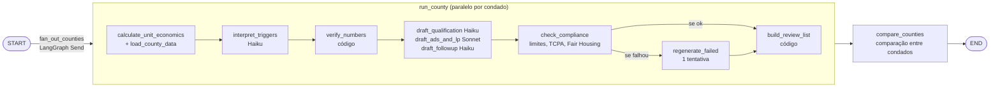

# county-campaign-builder

> 🇧🇷 PT-BR | 🇺🇸 [EN](README.md)

[](https://github.com/fgm9000/county-campaign-builder/actions/workflows/ci.yml)
[](https://github.com/fgm9000/county-campaign-builder/actions/workflows/codeql.yml)
[](https://fgm9000.github.io/county-campaign-builder/)
[](quality-baseline.json)
[](quality-baseline.json)
[](LICENSE)

**Motor de campanhas de aquisição paga e geração de leads por condado nos EUA — ancorado em dados reais de clima e estoque imobiliário.** O operador informa os condados alvo (códigos FIPS), a vertical, o lance por lead e as premissas de CPC e conversão. Em vez de gerar clichês genéricos de `{Cidade}` ou estatísticas acadêmicas frias, o pipeline traduz dados públicos oficiais (**U.S. Census ACS 2020–2024** e **NOAA Storm Events 2020–2024**) em anúncios e landing pages empáticos de alta conversão — combinados com matemática de leilão determinística em código, verificação anti-alucinação e travas de compliance. Projetado para demonstrar fluxos verificáveis de IA aplicados a growth, MarTech e mídia paga (Fase 1 ao vivo em aquisições residenciais; arquitetura por configuração pronta para Fase 2 em *roofing* / serviços residenciais).

> Demo de portfólio (POC), não é produto de cliente. O playground público usa respostas pré-computadas e premissas ilustrativas de CPC/CVR; o modo ao vivo roda só com código de acesso.

**Experimente em 30 segundos:** [fgm9000.github.io/county-campaign-builder](https://fgm9000.github.io/county-campaign-builder/).

---

## A regra dos 30 segundos

A primeira tela abre liderando com a **Dupla Perfeita** para aquisição paga orientada a margem — **persuasão ancorada em pressões locais reais** e **matemática que protege o leilão** — apoiadas por um escudo transparente de governança:

1. **Persuasão Guiada por Fatos (Tradução de Dados em Copy):**
   Pressões reais do estoque habitacional no Censo dos EUA (idade mediana dos imóveis, tempo de posse >25 anos, imóveis quitados, vacância) e histórico severo da NOAA orientam **anúncios Google RSA com tags de ângulo (5 títulos, 3 descrições), topo da landing page, SMS, e-mails e 5 perguntas de qualificação** por condado. Sem clichês genéricos de IA e sem jogar números acadêmicos crus: a copy converte proprietários motivados atacando dores concretas financeiras e de manutenção.

2. **Tabela de Matemática do Leilão por Condado com Semáforo** (lance alvo de `US$ 125,00` por lead):

   | Condado (FIPS) | Faixa de CPC | Conversão da LP | Faixa de CPL | CPC Máx. Viável | Semáforo |
   |---|---:|---:|---:|---:|---|
   | **Dallas County, TX** (`48113`) | `US$ 2,00–4,00` | `5,0%–10,0%` | `US$ 20,00–80,00` | `US$ 6,25` | 🟢 **Verde** — fecha em toda a faixa |
   | **Pinellas County, FL** (`12103`) | `US$ 4,50–9,00` | `6,0%–10,0%` | `US$ 45,00–150,00` | `US$ 7,50` | 🟡 **Amarelo** — fecha apenas no cenário favorável |
   | **Cook County, IL** (`17031`) | `US$ 11,00–15,00` | `5,0%–8,0%` | `US$ 137,50–300,00` | `US$ 6,25` | 🔴 **Vermelho** — ótimos gatilhos locais, mas **não fecha a conta** no CPC/CVR atual (melhor CPL `US$ 137,50` > lance `US$ 125,00`) |

   *Nota: as faixas de CPC e conversão da LP no benchmark são premissas ilustrativas do operador, nunca apresentadas como dado de mercado ao vivo das plataformas de anúncio.*

3. **Escudo de Governança — Alucinação da IA Capturada e Corrigida pelo Código:**
   No pacote de referência de Dallas County (`48113`), o LLM gerou **`US$ 350.000`** para `median_home_value_usd`. O registro oficial da **U.S. Census Bureau ACS (`Table B25077`)** em `data/counties.parquet` é **`US$ 303.000`**. O código detectou a divergência, substituiu `350000` por `303000`, marcou o fato como `corrected` e gravou a trilha de auditoria (`llm_value: 350000`, `source_value: 303000`).

---

## A tese: a IA propõe, o código verifica e calcula, o humano revisa

Pedir ao ChatGPT sozinho para *"escrever uma campanha para Cook County"* gera copy genérico, estatísticas sem fonte e campanhas que dão prejuízo silencioso no custo do clique. Aqui, a divisão de responsabilidades é aplicada pelo código:

| O que a IA (LLM) propõe | O que o código garante (`domain.py`, `economics.py`) | O que o humano revisa (`needs_human_review`) |
|---|---|---|
| Gatilhos de mercado citando estatísticas do condado (`field`, `value`, `source`) | Todo número citado é conferido contra `data/counties.parquet` (tolerância `±0,01`); divergências são corrigidas e registradas em `corrections`, e campos sem lastro ficam como `unverified` | Qualquer afirmação numérica `unverified` ou sensibilidade local |
| Estratégia de leilão e resumo comparativo | **Conta 100% em código:** `CPL = CPC ÷ CVR`, `CPC Máx. = Lance × CVR Mín.` e o semáforo `green`/`yellow`/`red` nunca dependem do LLM | Viabilidade do lance, premissas reais de CPC/CVR e decisão final de lançamento |
| 5 perguntas de qualificação, 5 títulos e 3 descrições RSA, topo da LP, 3 SMS e e-mails | Limites de caracteres (títulos ≤ 30, descrições ≤ 90, SMS ≤ 160), 5 tópicos obrigatórios de qualificação da vertical, remetente + opt-out + consentimento TCPA e regras de Fair Housing | Promessas de oferta (ex.: fechamento em 7 dias, garantia de compra no estado, avaliação), horários permitidos (quiet hours), termos do comprador e tom |

Ativos que falham em limites ou compliance são regenerados **uma única vez** com o motivo da falha no prompt; se falharem de novo, ficam marcados como `rejected` e nunca saem como aprovados.

---

## Como funciona



- **Divisão estruturada de LLMs:** `claude-haiku-4-5` interpreta os dados do condado em gatilhos e redige perguntas de qualificação, SMS e e-mails; `claude-sonnet-4-5` redige os títulos/descrições de Google Ads RSA e o topo da landing page. Todas as chamadas usam saída estruturada (DTOs Pydantic).
- **Tabela pré-agregada dos condados (sem API externa de dados em produção):** `scripts/build_county_table.py` (Polars) pré-calcula **3.222 condados dos EUA** (17 colunas, `122.909` bytes) em `data/counties.parquet` a partir da NOAA Storm Events (`2020–2024`), da tabela de correlação zona–condado da NWS (`bp16ap26.dbx`) e do Census ACS 5-year (`2020–2024`). Produção não depende da chave do Census nem de downloads da NOAA.
- **Verticais orientadas por configuração:** a Fase 1 em produção foca 100% em Motivated Seller (`motivated_seller`). O pipeline é modular via `config/verticals.json` — a Fase 2 no roadmap estende para Roofing & Home Services (`roofing`), com evals ao vivo e testes de campo pendentes.
- **Degradação explícita:** se um condado falha durante o *fan-out*, ele sai com `status: "failed"` enquanto os demais seguem normalmente; se a sumarização do `compare_counties` falhar no LLM, um fallback determinístico ordena pelo semáforo e pelo pior CPL.

Detalhes em [`docs/architecture.pt-BR.md`](docs/architecture.pt-BR.md).

---

## Playground público vs modo ao vivo

| Modo | Onde roda | Custo e acesso | Fluxo de dados |
|---|---|---|---|
| **Playground Público** | Página estática no GitHub Pages (`web/`) | Custo zero de servidor/API; aberto | Carrega `web/examples.json` pré-computado (gerado por `scripts/build_examples.py` com teste de drift em `tests/test_drift.py`). CSP estrita, sem bundlers, renderização exclusiva via `textContent`. |
| **Modo Ao Vivo** | Google Cloud Run (`county-campaign-builder`) | Protegido por `X-Access-Code`; teto de US$ 30/mês na Anthropic | O navegador recebe o progresso etapa por etapa via SSE (`POST /v1/campaigns/stream`, ou síncrono em `POST /v1/campaigns`) para qualquer um dos 3.222 condados dos EUA. |

### Proteções do modo ao vivo

1. **Código de acesso** (`X-Access-Code`), comparado em tempo constante (`hmac.compare_digest`); tentativas erradas têm limitador próprio por IP (`5/min`) para não consumir a cota diária.
2. **Limites de uso:** `5` requisições/minuto por IP (último salto de `X-Forwarded-For`) e cota global de `50` requisições/dia.
3. **Superfície de entrada estrita:** não há busca de URLs arbitrárias em produção (zero superfície de SSRF); todo `county_fips` enviado precisa existir em `data/counties.parquet` (`422` caso contrário).
4. **Logs sem PII:** uma linha JSON por requisição apenas com latência, contagens e veredito — nunca segredos, IPs ou texto de entrada (`hide_input_in_errors=True`).

---

## Playbook e planilha Excel

Para times de marketing e operações rodarem campanhas por condado manualmente sem escrever código:

- **[`playbook/README.md`](playbook/README.md):** Playbook operacional passo a passo para **ChatGPT** ou **Claude**, trazendo exatamente os mesmos templates de prompt de `src/county_campaign_builder/prompt.py` (garantido por teste de igualdade em `tests/test_playbook.py` para evitar divergência), além dos passos de conferência numérica e checklist de revisão humana.
- **[`playbook/auction-math.xlsx`](playbook/auction-math.xlsx):** Planilha gerada com `openpyxl` (`scripts/build_playbook.py`), com fórmulas reais de Excel / Google Sheets para `Best CPL`, `Worst CPL`, `Max Viable CPC`, formatação condicional para o semáforo `GREEN`/`YELLOW`/`RED` e abas de sensibilidade CPC × CVR para `Dallas County`, `Pinellas County` e `Cook County`.

---

## Stack, qualidade e decisões (ADRs)

| Camada | Escolha | ADR |
|---|---|---|
| Linguagem e tooling | Python 3.12, `uv`, Ruff, mypy `--strict`, Pytest, Pydantic v2 | [001](docs/decisions/001-stack-and-tooling.pt-BR.md) |
| Orquestração | LangGraph (`StateGraph` com fan-out paralelo via `Send` e `compare_counties`) | [001](docs/decisions/001-stack-and-tooling.pt-BR.md) |
| LLM | Anthropic: `claude-haiku-4-5` (gatilhos, qualificação, follow-up) e `claude-sonnet-4-5` (anúncios RSA, LP) | [001](docs/decisions/001-stack-and-tooling.pt-BR.md) |
| Núcleo e guardrails | A IA propõe; o código verifica números, calcula leilão, aplica TCPA/Fair Housing e marca revisão | [002](docs/decisions/002-core-architecture-and-guardrails.pt-BR.md) |
| Hospedagem e segurança | Google Cloud Run, deploy keyless (WIF), Secret Manager, código de acesso, rate limits | [003](docs/decisions/003-cloud-run-security.pt-BR.md) |
| Avaliação | DeepEval: 5 métricas determinísticas no CI (`evals/`); G-Eval (juiz `claude-opus-5-5`) sob demanda | [004](docs/decisions/004-llm-evaluation-strategy.pt-BR.md) |
| Frontend | Playground estático bilíngue (EN/PT) com CSP estrita e `examples.json` com teste de drift | [005](docs/decisions/005-static-web-playground.pt-BR.md) |
| Pipeline de dados | ETL em Polars sobre NOAA Storm Events, mapa de zonas NWS e Census ACS → `data/counties.parquet` | [006](docs/decisions/006-county-data-pipeline.pt-BR.md) |
| Reuso de motor | FastAPI/SSE, settings, rate limiter e catraca adaptados do `briefing-scout` | [007](docs/decisions/007-reuse-from-briefing-scout.pt-BR.md) |
| Entregáveis não-código | `playbook/README.md` (sincronizado com `prompt.py`) + `playbook/auction-math.xlsx` (`openpyxl`) | [008](docs/decisions/008-playbook-and-spreadsheet.pt-BR.md) |

- **Baseline de qualidade ([`quality-baseline.json`](quality-baseline.json)):** `140` testes passando (`0` pulados), `100,0%` de cobertura, `0` problemas no Ruff, `0` erros no mypy `--strict`, `0` supressões.
- **Documentação complementar:** [PRD](docs/prd.pt-BR.md) · [Arquitetura](docs/architecture.pt-BR.md) · [Runbook de Deploy](docs/deployment-runbook.pt-BR.md) · [Spikes](docs/spikes.pt-BR.md) · [Plano](docs/plano-implementacao.pt-BR.md) · [Controle de Progresso](docs/controle-progresso.pt-BR.md)

---

## Guia rápido para desenvolvedores

### Modo offline / fake (sem chaves, sem custo)

```bash
git clone https://github.com/fgm9000/county-campaign-builder.git
cd county-campaign-builder
uv sync

# Rodar testes unitários e de integração
uv run pytest

# Catraca completa: ruff + mypy --strict + 100% de cobertura + zero supressões
uv run python scripts/quality_check.py

# Evals determinísticas do CI (5 métricas DeepEval + injeções de falha)
DEEPEVAL_TELEMETRY_OPT_OUT=1 uv run pytest evals/ -q

# API local em modo fake (cenários Dallas, Pinellas e Cook)
FAKE_MODEL=1 uv run uvicorn county_campaign_builder.api:create_app_from_env --factory --port 8077

# Playground estático local (em outro terminal)
uv run python -m http.server 8090 --directory web
```

### Modo ao vivo e geração de artefatos

O modo ao vivo exige `ANTHROPIC_API_KEY` e `LIVE_ACCESS_CODE` no ambiente (sem elas o app não sobe, listando apenas o nome das variáveis ausentes):

```bash
FAKE_MODEL=0 uv run uvicorn county_campaign_builder.api:create_app_from_env --factory --port 8077

# G-Eval sob demanda com modelos reais da Anthropic
LIVE_EVAL=1 uv run pytest evals/test_copy_live.py -q

# Regerar fixtures da página estática ou artefatos do playbook
uv run python scripts/build_examples.py
uv run python scripts/build_playbook.py
```

Instruções de deploy: [`docs/deployment-runbook.pt-BR.md`](docs/deployment-runbook.pt-BR.md).

---

## Estrutura

```text
src/county_campaign_builder/
  models.py        contratos Pydantic v2 imutáveis (extra="forbid")
  county_data.py   agregação e leitura de NOAA Storm Events + NWS + Census ACS
  economics.py     cálculo puro de CPL, CPC máximo viável e semáforo
  domain.py        verificador numérico, limites de caracteres, Fair Housing, TCPA, revisão humana
  prompt.py        prompts determinísticos compartilhados com playbook/README.md
  llm.py           cliente Anthropic (Haiku + Sonnet estruturado) e modelo falso determinístico
  graph.py         grafo LangGraph (fan-out com Send, pipeline por condado, compare_counties)
  api.py           FastAPI, streaming SSE, guarda de código de acesso, validação FIPS, logs JSON
  limits.py        rate limit deslizante por IP e cota diária global
  settings.py      configuração tipada via pydantic-settings (hide_input_in_errors=True)
config/            definições por vertical (motivated_seller, roofing) e regras de compliance
data/              counties.parquet pré-calculado (3.222 condados), metadados e fontes brutas
evals/             suíte determinística DeepEval e G-Eval ao vivo
playbook/          playbook não-código (README.md) e planilha Excel (auction-math.xlsx)
scripts/           ETL, geradores de exemplos e playbook, catraca de qualidade, smoke test
tests/             140 testes unitários, integração, drift e sincronismo do playbook
web/               playground estático bilíngue (index.html, app.js, styles.css, examples.json)
docs/              PRD, ADRs (001–008), arquitetura, runbook de deploy, spikes e progresso
```

---

## Limitações e próximos passos

- **Apenas agregados públicos:** usa dados gratuitos por condado da NOAA e do Census ACS 5-year; bases pagas por imóvel (pré-execução hipotecária ou impostos atrasados, como ATTOM) ficam fora da POC.
- **Premissas de leilão informadas pelo operador:** as faixas de CPC e conversão da LP são entradas do operador, não consultas em tempo real a APIs de plataformas de anúncio.
- **Foco em texto e compliance:** gera e valida copy e qualificação; não configura segmentação de público nas plataformas, automação de lances nem criativos em imagem/vídeo.
- **Playground público estático:** o modo público é somente leitura sobre `web/examples.json`; execuções ao vivo exigem código de acesso e respeitam limites por IP e cota diária.

---

## Licença

[PolyForm Noncommercial 1.0.0](LICENSE) © 2026 Fabio Moura.
