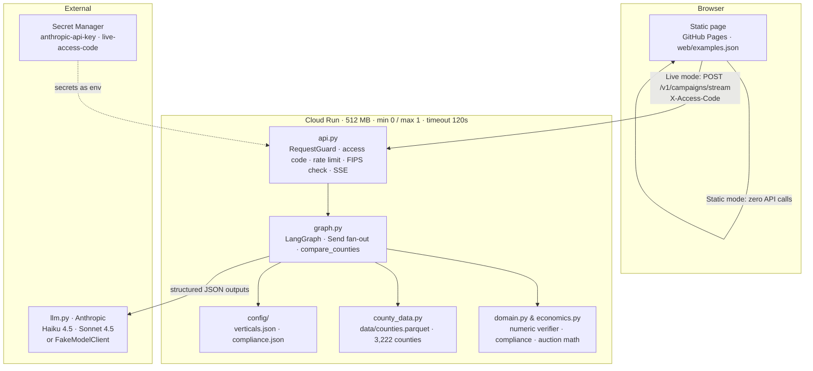
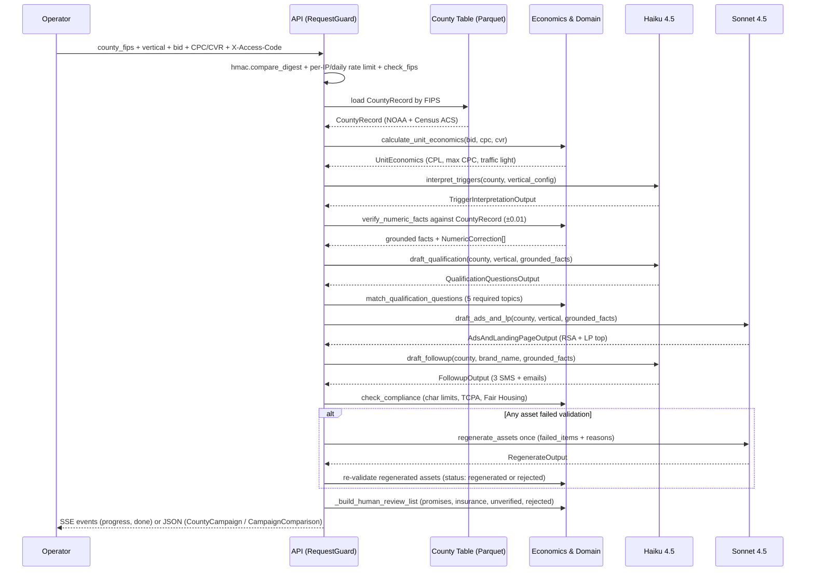

# Architecture — county-campaign-builder

> 🇺🇸 EN | 🇧🇷 [PT-BR](architecture.pt-BR.md) · Based on ADRs [001](decisions/001-stack-and-tooling.pt-BR.md) to [008](decisions/008-playbook-and-spreadsheet.pt-BR.md)

## 1. Overview & System Topology

The application operates in two cleanly separated modes:

- **Static mode (default public playground):** The GitHub Pages frontend (`web/index.html`, `web/app.js`) reads pre-computed scenarios from `web/examples.json`, which is generated offline by `scripts/build_examples.py` using the real LangGraph workflow in fake mode (`FakeModelClient`) and guarded against code drift by `tests/test_drift.py`. It incurs **zero API or server cost**.
- **Live mode:** From the "Live County Run" tab, an operator submits any of the 3,222 U.S. county FIPS codes, a vertical (`motivated_seller` or `roofing`), a lead bid, and CPC/CVR ranges with the `X-Access-Code` header. The Cloud Run API (`api.py`) authenticates the request, validates the FIPS code against `data/counties.parquet`, runs the pipeline against the Anthropic API (`claude-haiku-4-5` and `claude-sonnet-4-5`), and streams stage-by-stage `progress` events followed by `done` (or `error`) via Server-Sent Events (`POST /v1/campaigns/stream`, with a synchronous `POST /v1/campaigns` endpoint also available).

---

## 2. Pipeline of a County Campaign

### Modules and responsibilities

| Module | Responsibility | Depends on |
|---|---|---|
| `models.py` | Immutable Pydantic v2 `Contract` models (`CampaignInput`, `MultiCountyInput`, `CountyCampaign`, `CampaignComparison`); Unicode NFC normalization and FIPS pattern validation | — |
| `county_data.py` | Pure Polars ingestion/aggregation functions for NOAA Storm Events, NWS zone-county map, and Census ACS; `load_county_table` (`data/counties.parquet` -> `dict[str, CountyRecord]`) | `polars`, `pydantic` |
| `economics.py` | Pure deterministic auction math: `calculate_cpl`, `calculate_max_cpc`, `evaluate_traffic_light`, `calculate_unit_economics` | `models` |
| `domain.py` | Pure domain guardrails: `verify_numeric_facts`, `check_character_limit`, `find_fair_housing_violations`, `validate_sms`, `validate_consent_disclosure`, `detect_human_review_triggers`, `match_qualification_questions` | `county_data`, `models` |
| `prompt.py` | Deterministic prompt builders for triggers, qualification, ads/LP, follow-up, targeted regeneration, and comparison (shared verbatim with `playbook/README.md`) | `county_data`, `domain`, `models` |
| `llm.py` | `ModelClient` (`Protocol`), structured output DTOs, `AnthropicModelClient` (`claude-haiku-4-5` & `claude-sonnet-4-5`), and deterministic `FakeModelClient` (including the Dallas hail trap) | `county_data`, `domain`, `models`, `prompt`, `anthropic` SDK |
| `graph.py` | `run_county_pipeline`, LangGraph `Send` fan-out (`fan_out_counties`), `compare_counties_node`, `run_campaign`, and `run_multi_campaign` | all of the above |
| `limits.py` | `StrictRateLimiter` (60 s sliding window per IP + UTC daily quota) and `client_ip` (`X-Forwarded-For` last hop) | — |
| `settings.py` | Typed `pydantic-settings` configuration with `hide_input_in_errors=True` and live-mode secret validation | `pydantic-settings` |
| `api.py` | FastAPI app, `RequestGuard`, `/v1/campaigns`, `/v1/campaigns/stream` (SSE), `/health`, CORS, and PII-free JSON logging | all of the above |

External LLM access enters through the `ModelClient` `Protocol` and is injected via `CampaignDependencies`, allowing the full pipeline and evaluation suite to execute offline in CI with 100% test coverage.

---

## 3. LangGraph Fan-Out with `Send`

Multi-county runs (`MultiCountyInput`, up to `MAX_COUNTIES_PER_COMPARISON = 10` unique FIPS codes) execute through a compiled `StateGraph(OverallState)` in `graph.py`:

- **State typing & reducer:**
  - `OverallState` holds the shared request inputs (`county_fips_list`, `vertical`, `bid_per_lead_usd`, `cpc_usd`, `landing_cvr`), the accumulated list `campaigns: Annotated[list[CountyCampaign], operator.add]`, and `comparison: CampaignComparison | None`.
  - Each parallel worker receives a `CountyInputDict` payload containing its single target `fips` and the shared economic parameters.
- **Parallel dispatch via `Send`:**
  - `fan_out_counties(state)` is registered as a conditional edge from `START` and emits `[Send("run_county", {...}) for fips in state["county_fips_list"]]`, dispatching each county independently in parallel.
  - Each `run_county` node calls `run_county_pipeline(state, deps)` and returns `{"campaigns": [campaign]}`, merged via `operator.add`.
- **Independent isolation & graceful degradation:**
  - `run_county_pipeline` wraps the entire single-county execution in a `try/except` block. If a county has an unknown FIPS, an unknown vertical, or encounters an `LlmError` / unexpected exception, only that branch returns `CountyCampaign(status="failed", error_message=..., unit_economics=...)` (falling back to `_fallback_unit_economics` if economics had not yet run). Sibling county branches continue unaffected.
- **Aggregation & recommendation (`compare_counties`):**
  - After all `Send` branches finish, `compare_counties_node` sorts `state["campaigns"]` back into the original `county_fips_list` order, formats grounded per-county summaries via `_summarize_campaign`, and calls `deps.model.compare_counties(summaries)` (`claude-sonnet-4-5`) to produce the executive `CampaignComparison`.
  - If all county branches failed or if `compare_counties` raises `LlmError`, `_fallback_comparison` deterministically selects the best successful county by `_VERDICT_PRIORITY` (`green` < `yellow` < `red`) and lowest worst-case CPL (`cpl_worst_usd`).

---

## 4. Ground Truth Data Architecture (ADR 006)

Rather than querying live public APIs at runtime, county ground truth is pre-computed offline into a single read-only dataset:

- **Polars ETL (`scripts/build_county_table.py` + `county_data.py`):**
  1. **NOAA Storm Events (`2020–2024`, release `c20261118`):** Reads annual `StormEvents_details-ftp_v1.0_d<YEAR>_c20261118.csv.gz` files (`latin-1` CSV) and filters four hazard types:
     - `Hail` with `MAGNITUDE >= 1.0` inch (county rows `CZ_TYPE == "C"`).
     - `Thunderstorm Wind` with `MAGNITUDE >= 50.0` knots (county rows `CZ_TYPE == "C"`).
     - `Tornado` events (county rows `CZ_TYPE == "C"`).
     - Tropical events (`Hurricane (Typhoon)`, `Tropical Storm`, `Tropical Depression`): zone rows (`CZ_TYPE == "Z"`) are fanned out across all counties covered by each NWS forecast zone via the NWS zone-county crosswalk (`bp16ap26.dbx`), and county rows are kept directly.
     - Records are deduplicated by `(EVENT_ID, fips, kind)` and aggregated per 5-digit county FIPS.
  2. **U.S. Census ACS 5-year (`2020–2024`):** Queries `/data/2024/acs/acs5` for county-level housing variables: median year built (`B25035_001E`), households and owner-occupied units (`B25003_001E`, `B25003_002E`), total and vacant housing units (`B25002_001E`, `B25002_003E`), median home value (`B25077_001E`), owner tenure before 2000 (`B25038_007E + B25038_008E` over `B25038_002E`), and free-and-clear ownership (`B25081_009E` over `B25081_001E`). Negative Census sentinel values are converted to `null`.
  3. **Join & output:** Left-joins storm counts onto the Census county base (filling counties without recorded events with `0`) and writes Zstandard-compressed `data/counties.parquet` (**3,222 U.S. counties**, 17 columns, **122,909 bytes / ~122 KB**) alongside `data/counties_meta.json`.
- **Why pre-compute:** Eliminates external data API latency, Census API rate limits, and large NOAA CSV downloads in Cloud Run. Most importantly, `CENSUS_API_KEY` is used **only** by the offline ETL script and is never stored in the repository or deployed to production.

---

## 5. Guardrails & Compliance Architecture (ADR 002)

The core thesis is **AI proposes; code verifies, computes, and routes human review**:

| Risk | Protection | Where |
|---|---|---|
| Hallucinated or misquoted statistics | Every trigger cites `field` and `value`; checked against `CountyRecord` (`±0.01` float tolerance or exact int). Mismatches are overwritten with `source_value`, marked `corrected`, and logged in `corrections`; unbacked fields become `unverified` and are excluded from `grounded_facts` | `domain.verify_numeric_facts`, `graph.py` |
| Auction math errors | 100% deterministic code: `CPL = round(CPC / CVR, 2)`, `Max CPC = round(Bid × Min CVR, 2)`, and `green`/`yellow`/`red` classification against `bid_per_lead_usd` | `economics.calculate_unit_economics` |
| Ad & SMS length overruns | RSA headlines `≤ 30` chars, RSA descriptions `≤ 90` chars, SMS `≤ 160` chars (measured on NFC-normalized text) | `domain.check_character_limit`, `config/compliance.json` |
| Fair Housing Act violations (`42 U.S.C. 3604`) | Case-insensitive regex scan across all ad, landing page, SMS, and email fields covering familial status, race/religion/national origin, disability, and blockbusting (`fha-blockbusting`) | `domain.find_fair_housing_violations`, `config/compliance.json` |
| TCPA SMS & consent gaps (`47 CFR 64.1200`) | Every SMS must contain the vertical `brand_name` and a standardized opt-out keyword (`STOP`, `QUIT`, `END`, `REVOKE`, `OPT OUT`, `CANCEL`, `UNSUBSCRIBE`); landing page `consent_disclosure` must contain `"automated"`, `"not a condition"`, and `"stop"` | `domain.validate_sms`, `domain.validate_consent_disclosure` |
| Missing qualification intake topics | Generated questions are matched via regex keywords against the 5 `required_question_topics` of the chosen vertical; missing topics are flagged for human review | `domain.match_qualification_questions`, `config/verticals.json` |
| Persistent compliance failures | Failed assets are sent through `regenerate_assets` (`claude-sonnet-4-5`) **once** with the exact failure reasons; items that fail re-validation remain `status="rejected"` and are never marked approved | `graph._regenerate_failed_assets` |
| Unverifiable buyer promises & claims | Promises of speed/price/no-fees (`review-offer-terms`) and insurance coverage claims (`review-insurance-claims`), plus `unverified` facts, missing qualification topics, and `rejected`/`missing` assets are routed to `needs_human_review` | `domain.detect_human_review_triggers`, `graph._build_human_review_list` |

---

## 6. Security & Operational Architecture (ADR 003)

| Layer | Detail |
|---|---|
| Zero PII & no database | No database and no direct SQL writes; all county reference data is read-only from `data/counties.parquet`. Single-line JSON logs (`api.log_event`) record only `event`, `status_code`, `mode`, `latency_ms`, `county_fips`, `vertical`, and aggregate counts/verdicts — never secrets, IP addresses, or raw inputs |
| Access code & brute-force guard | `X-Access-Code` is validated in constant time (`hmac.compare_digest`). Invalid attempts use a dedicated per-IP `StrictRateLimiter` (`5/min`, `FAILED_CODES_DAILY_CAP = 1,000,000`) so brute-force guesses cannot consume the legitimate daily quota |
| Rate limiting | `StrictRateLimiter` enforces a 60 s sliding window per client IP (last hop of `X-Forwarded-For`, default `5 req/min`) plus a global UTC daily quota (`50 req/day`). HTTP 429 includes `Retry-After` (exposed via CORS) |
| Input surface (zero SSRF) | No runtime URL fetching; every requested `county_fips` must exist in `data/counties.parquet` (`HTTP 422` otherwise) |
| Configuration & frontend | `Settings` sets `hide_input_in_errors=True` so missing/invalid config never echoes secret values. Static UI enforces a strict `<meta http-equiv="Content-Security-Policy">` and renders all dynamic data via `textContent` only |
| Keyless WIF & least-privilege IAM | `.github/workflows/deploy.yml` authenticates via GCP Workload Identity Federation (restricted to `fgm9000/county-campaign-builder` on `main`). Deploy SA (`county-campaign-deploy`) holds `roles/run.developer`, `roles/artifactregistry.writer`, and `roles/iam.serviceAccountUser` on the runtime SA only; runtime SA (`county-campaign-runtime`) has zero project-level roles and `secretAccessor` solely on `anthropic-api-key` and `county-campaign-live-access-code` |
| Container & Cloud Run limits | Multi-stage `Dockerfile` (`python:3.12-slim` + `uv sync --frozen --no-dev --no-editable`) runs as non-root `appuser` (uid/gid `10001`). Cloud Run: `--memory=512Mi --cpu=1 --timeout=120 --min-instances=0 --max-instances=1 --concurrency=10` |

---

## 7. Evaluation Architecture (ADR 004)

Quality and guardrails are verified at two levels under `evals/`:

- **Deterministic DeepEval metrics in CI (`evals/metrics.py`, `evals/test_deterministic.py`, offline fake mode):**
  1. `NumericAccuracyMetric`: verifies every `verified`/`corrected` fact matches `data/counties.parquet` and that any discrepancy (such as the planted Dallas `120` vs `102` hail trap) is recorded in `corrections`.
  2. `CharacterLimitMetric`: enforces `≤ 30` chars on approved/regenerated headlines, `≤ 90` on descriptions, and `≤ 160` on SMS.
  3. `ComplianceMetric`: enforces TCPA brand identification and opt-out keywords on SMS, TCPA written-consent phrases on the landing page, and zero Fair Housing violations across all approved/regenerated assets.
  4. `QualificationCoverageMetric`: verifies all 5 `required_question_topics` of the vertical are covered.
  5. `EconomicsMetric`: independently recalculates `calculate_unit_economics` and verifies `cpl_best_usd`, `cpl_worst_usd`, `max_cpc_usd`, and `verdict`.
  - Paired with negative fault-injection tests confirming each metric detects injected violations.
- **Live G-Eval (`evals/test_copy_live.py`, manual `LIVE_EVAL=1`):**
  - Runs the real Anthropic pipeline (`claude-haiku-4-5` + `claude-sonnet-4-5`) across 4 canonical cases (`dallas_motivated_seller`, `pinellas_motivated_seller`, `cook_motivated_seller`, `dallas_roofing`).
  - Evaluates all 5 deterministic metrics plus a `GEval` copy-quality metric (`GEVAL_THRESHOLD = 0.7`) using `claude-opus-5-5` as an independent judge model over local relevance, proposition clarity, absence of generic cliches, and homeowner readability, writing a structured report to `eval-results-live.json`.
- **Artifact & prompt synchronization checks:** `tests/test_drift.py` ensures `web/examples.json` never drifts from the graph, and `tests/test_playbook.py` enforces exact synchronization between `src/county_campaign_builder/prompt.py` and the non-code `playbook/README.md`.
