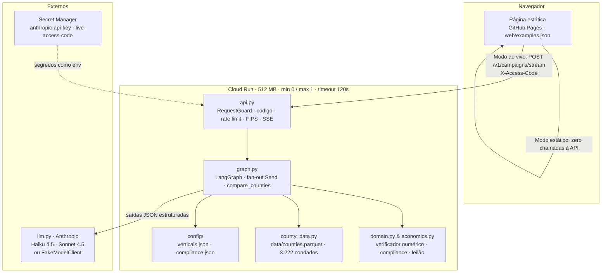
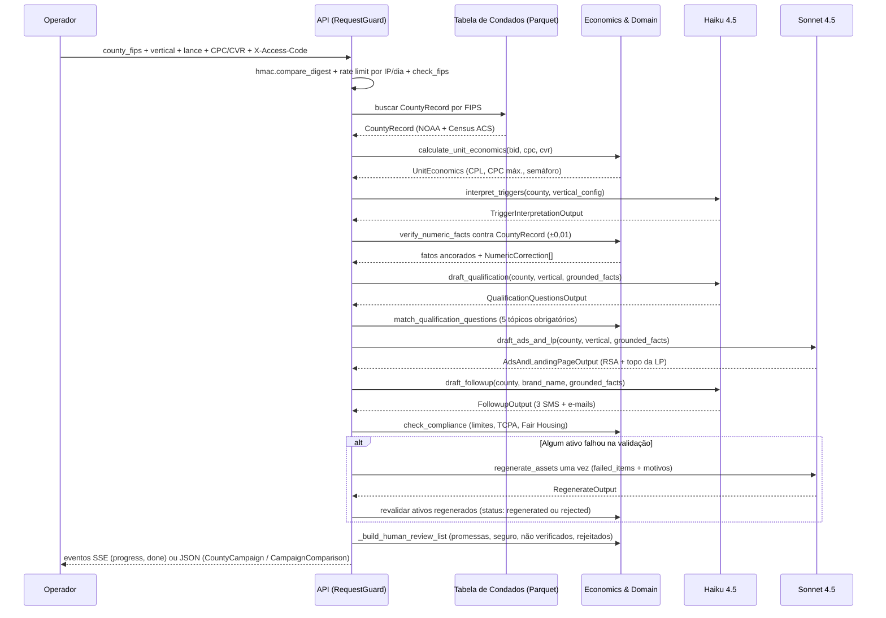

# Arquitetura — county-campaign-builder

> 🇧🇷 PT-BR | 🇺🇸 [EN](architecture.md) · Base: ADRs [001](decisions/001-stack-and-tooling.pt-BR.md) a [008](decisions/008-playbook-and-spreadsheet.pt-BR.md)

## 1. Visão geral e topologia do sistema

A aplicação opera em dois modos claramente separados:

- **Modo estático (playground público padrão):** A página no GitHub Pages (`web/index.html`, `web/app.js`) lê cenários pré-computados de `web/examples.json`, gerados offline por `scripts/build_examples.py` com o grafo real em modo fake (`FakeModelClient`) e protegidos contra deriva por `tests/test_drift.py`. Tem **custo zero de API e servidor**.
- **Modo ao vivo:** Na aba "Execução ao vivo", o operador envia qualquer um dos 3.222 códigos FIPS de condados dos EUA, a vertical (`motivated_seller` ou `roofing`), o lance por lead e as faixas de CPC/CVR com o cabeçalho `X-Access-Code`. A API no Cloud Run (`api.py`) autentica a requisição, valida o FIPS em `data/counties.parquet`, executa o pipeline na API da Anthropic (`claude-haiku-4-5` e `claude-sonnet-4-5`) e transmite eventos de progresso etapa a etapa (`progress`, `done` ou `error`) via Server-Sent Events (`POST /v1/campaigns/stream`, além da rota síncrona `POST /v1/campaigns`).

---

## 2. O fluxo de uma campanha de condado

### Módulos e responsabilidades

| Módulo | Responsabilidade | Depende de |
|---|---|---|
| `models.py` | Contratos `Contract` Pydantic v2 imutáveis (`CampaignInput`, `MultiCountyInput`, `CountyCampaign`, `CampaignComparison`); normalização NFC e validação de FIPS | — |
| `county_data.py` | Funções puras em Polars para NOAA Storm Events, mapa zona-condado do NWS e Census ACS; `load_county_table` (`data/counties.parquet` → `dict[str, CountyRecord]`) | `polars`, `pydantic` |
| `economics.py` | Matemática determinística pura do leilão: `calculate_cpl`, `calculate_max_cpc`, `evaluate_traffic_light`, `calculate_unit_economics` | `models` |
| `domain.py` | Guardrails puros de domínio: `verify_numeric_facts`, `check_character_limit`, `find_fair_housing_violations`, `validate_sms`, `validate_consent_disclosure`, `detect_human_review_triggers`, `match_qualification_questions` | `county_data`, `models` |
| `prompt.py` | Construtores determinísticos de prompt para gatilhos, qualificação, anúncios/LP, follow-up, regeneração direcionada e comparação (compartilhados literalmente com `playbook/README.md`) | `county_data`, `domain`, `models` |
| `llm.py` | `ModelClient` (`Protocol`), DTOs estruturados, `AnthropicModelClient` (`claude-haiku-4-5` e `claude-sonnet-4-5`) e `FakeModelClient` determinístico (incluindo a armadilha de granizo em Dallas) | `county_data`, `domain`, `models`, `prompt`, SDK `anthropic` |
| `graph.py` | `run_county_pipeline`, fan-out LangGraph com `Send` (`fan_out_counties`), `compare_counties_node`, `run_campaign` e `run_multi_campaign` | todos acima |
| `limits.py` | `StrictRateLimiter` (janela deslizante de 60 s por IP + cota diária UTC) e `client_ip` (último salto de `X-Forwarded-For`) | — |
| `settings.py` | Configuração tipada com `pydantic-settings`, `hide_input_in_errors=True` e validação de segredos em modo ao vivo | `pydantic-settings` |
| `api.py` | App FastAPI, `RequestGuard`, `/v1/campaigns`, `/v1/campaigns/stream` (SSE), `/health`, CORS e logs JSON sem PII | todos acima |

Toda dependência externa de modelo entra pelo `Protocol` `ModelClient` e é injetada via `CampaignDependencies`. Por isso o CI executa todo o grafo e a suíte de avaliação offline, com 100% de cobertura.

---

## 3. Fan-Out em LangGraph com `Send`

Execuções multi-condado (`MultiCountyInput`, até `MAX_COUNTIES_PER_COMPARISON = 10` códigos FIPS únicos) rodam sobre um `StateGraph(OverallState)` compilado em `graph.py`:

- **Tipagem de estado e reducer:**
  - `OverallState` armazena os parâmetros compartilhados (`county_fips_list`, `vertical`, `bid_per_lead_usd`, `cpc_usd`, `landing_cvr`), a lista acumulada `campaigns: Annotated[list[CountyCampaign], operator.add]` e `comparison: CampaignComparison | None`.
  - Cada trabalhador paralelo recebe um payload `CountyInputDict` com o seu `fips` alvo e os parâmetros econômicos compartilhados.
- **Despacho paralelo com `Send`:**
  - `fan_out_counties(state)` é registrado como aresta condicional a partir de `START` e retorna `[Send("run_county", {...}) for fips in state["county_fips_list"]]`, disparando cada condado de forma independente e em paralelo.
  - Cada nó `run_county` executa `run_county_pipeline(state, deps)` e retorna `{"campaigns": [campaign]}`, agregado pelo reducer `operator.add`.
- **Isolamento independente e degradação graciosa:**
  - `run_county_pipeline` envolve toda a execução por condado em `try/except`. Se um condado falhar (FIPS desconhecido, vertical inválida, `LlmError` ou exceção inesperada), apenas aquele ramo retorna `CountyCampaign(status="failed", error_message=..., unit_economics=...)` (usando `_fallback_unit_economics` se a economia ainda não tiver sido calculada). Os demais condados continuam normalmente e a comparação é concluída.
- **Agregação e recomendação (`compare_counties`):**
  - Após o término de todos os ramos `Send`, `compare_counties_node` reordena `state["campaigns"]` pela ordem original de `county_fips_list`, resume os dados ancorados com `_summarize_campaign` e chama `deps.model.compare_counties(summaries)` (`claude-sonnet-4-5`) para gerar o `CampaignComparison`.
  - Se todos os condados falharem ou se `compare_counties` levantar `LlmError`, `_fallback_comparison` seleciona deterministicamente o melhor condado bem-sucedido por `_VERDICT_PRIORITY` (`green` < `yellow` < `red`) e menor CPL no pior cenário (`cpl_worst_usd`).

---

## 4. Arquitetura de Dados de Referência (ADR 006)

Em vez de consultar APIs públicas em tempo de execução, a base de condados é pré-computada offline em um único artefato somente leitura:

- **Pipeline ETL em Polars (`scripts/build_county_table.py` + `county_data.py`):**
  1. **NOAA Storm Events (`2020–2024`, release `c20261118`):** Lê os CSVs anuais `StormEvents_details-ftp_v1.0_d<YEAR>_c20261118.csv.gz` (`latin-1`) e filtra quatro tipos de evento:
     - `Hail` com `MAGNITUDE >= 1.0` polegada (registros de condado `CZ_TYPE == "C"`).
     - `Thunderstorm Wind` com `MAGNITUDE >= 50.0` nós (registros de condado `CZ_TYPE == "C"`).
     - `Tornado` (registros de condado `CZ_TYPE == "C"`).
     - Eventos tropicais (`Hurricane (Typhoon)`, `Tropical Storm`, `Tropical Depression`): registros por zona (`CZ_TYPE == "Z"`) são expandidos para todos os condados cobertos pela zona NWS usando o mapeamento `bp16ap26.dbx`, somados aos registros diretos de condado.
     - Os registros são deduplicados por `(EVENT_ID, fips, kind)` e agregados por código FIPS de 5 dígitos.
  2. **U.S. Census ACS 5-year (`2020–2024`):** Consulta `/data/2024/acs/acs5` em nível de condado: ano mediano de construção (`B25035_001E`), posse (`B25003`), vacância (`B25002`), valor mediano do imóvel (`B25077_001E`), proprietários com longo tempo de moradia pré-2000 (`B25038_007E + B25038_008E / B25038_002E`) e imóveis quitados sem hipoteca (`B25081_009E / B25081_001E`). Sentinelas negativos do Census viram `null`.
  3. **Junção e saída:** Faz left-join das contagens de tempestades na base do Census (preenchendo condados sem eventos com `0`) e grava `data/counties.parquet` com compressão Zstandard (**3.222 condados dos EUA**, 17 colunas, **122.909 bytes / ~122 KB**) além de `data/counties_meta.json`.
- **Por que pré-computar:** Elimina latência de APIs externas, limites de taxa do Census e downloads pesados da NOAA no Cloud Run. A chave `CENSUS_API_KEY` é usada **apenas** no script offline e nunca entra no repositório nem em produção.

---

## 5. Arquitetura de Guardrails e Compliance (ADR 002)

A tese central é **a IA propõe; o código verifica, calcula e encaminha para revisão humana**:

| Risco | Proteção | Onde |
|---|---|---|
| Estatística alucinada ou incorreta | Todo número citado traz `field` e `value`; comparado com `CountyRecord` (tolerância `±0,01` em float ou exata em int). Divergências são sobrescritas com `source_value`, marcadas como `corrected` e registradas em `corrections`; campos sem origem viram `unverified` e ficam fora de `grounded_facts` | `domain.verify_numeric_facts`, `graph.py` |
| Erro de conta do leilão | 100% código determinístico: `CPL = round(CPC / CVR, 2)`, `CPC máx. = round(Bid × CVR mín., 2)` e classificação `green`/`yellow`/`red` contra `bid_per_lead_usd` | `economics.calculate_unit_economics` |
| Estouro de caracteres em anúncios e SMS | Títulos RSA `≤ 30`, descrições RSA `≤ 90` e SMS `≤ 160` caracteres (medidos após normalização Unicode NFC) | `domain.check_character_limit`, `config/compliance.json` |
| Violação de Fair Housing (`42 U.S.C. 3604`) | Varredura por regex (case-insensitive) em anúncios, LP, SMS e e-mails cobrindo classes protegidas (status familiar, raça/religião/origem nacional, deficiência) e blockbusting (`fha-blockbusting`) | `domain.find_fair_housing_violations`, `config/compliance.json` |
| Falhas de TCPA em SMS e consentimento (`47 CFR 64.1200`) | Todo SMS deve identificar `brand_name` da vertical e trazer palavra-chave de saída (`STOP`, `QUIT`, `END`, `REVOKE`, `OPT OUT`, `CANCEL`, `UNSUBSCRIBE`); o `consent_disclosure` da LP exige `"automated"`, `"not a condition"` e `"stop"` | `domain.validate_sms`, `domain.validate_consent_disclosure` |
| Tópicos ausentes na qualificação | Perguntas geradas são casadas por regex com os 5 `required_question_topics` da vertical; tópicos ausentes entram na revisão humana | `domain.match_qualification_questions`, `config/verticals.json` |
| Falha persistente de compliance | Ativos reprovados são regenerados **uma vez** via `regenerate_assets` (`claude-sonnet-4-5`) com os motivos da falha; se falharem de novo, permanecem `status="rejected"` e nunca são emitidos como aprovados | `graph._regenerate_failed_assets` |
| Promessas não verificáveis pelo código | Promessas de prazo/preço/isenção (`review-offer-terms`) e alegações de cobertura de seguro (`review-insurance-claims`), além de fatos `unverified`, tópicos ausentes e ativos `rejected`/`missing`, vão para `needs_human_review` | `domain.detect_human_review_triggers`, `graph._build_human_review_list` |

---

## 6. Segurança e Arquitetura Operacional (ADR 003)

| Camada | Detalhe |
|---|---|
| Zero PII e sem banco de dados | Sem banco de dados e sem escritas SQL diretas; os dados de condado são lidos em modo somente leitura de `data/counties.parquet`. Logs JSON de uma linha (`api.log_event`) registram apenas `event`, `status_code`, `mode`, `latency_ms`, `county_fips`, `vertical` e contagens/vereditos agregados — nunca segredos, IPs ou entradas brutas |
| Código de acesso e anti-força bruta | `X-Access-Code` validado em tempo constante (`hmac.compare_digest`). Tentativas inválidas usam um `StrictRateLimiter` separado por IP (`5/min`, `FAILED_CODES_DAILY_CAP = 1.000.000`) para não esgotar a cota diária legítima |
| Rate limiting | `StrictRateLimiter` aplica janela deslizante de 60 s por IP (último salto de `X-Forwarded-For`, padrão `5 req/min`) e cota diária global UTC (`50 req/dia`). HTTP 429 devolve `Retry-After` (exposto via CORS) |
| Superfície de entrada (zero SSRF) | Sem busca de URLs em runtime; todo `county_fips` precisa existir em `data/counties.parquet` (caso contrário retorna `HTTP 422`) |
| Configuração e frontend | `Settings` define `hide_input_in_errors=True` para nunca vazar segredos em erros. A página estática impõe `<meta http-equiv="Content-Security-Policy">` estrita e renderiza textos dinâmicos exclusivamente via `textContent` |
| WIF keyless e menor privilégio | `.github/workflows/deploy.yml` autentica via GCP Workload Identity Federation (restrito a `fgm9000/county-campaign-builder` na `main`). A SA de deploy (`county-campaign-deploy`) tem `roles/run.developer`, `roles/artifactregistry.writer` e `roles/iam.serviceAccountUser` apenas sobre a SA de runtime; a SA de runtime (`county-campaign-runtime`) tem zero papéis no projeto e `secretAccessor` apenas em `anthropic-api-key` e `county-campaign-live-access-code` |
| Container e limites no Cloud Run | `Dockerfile` multi-stage (`python:3.12-slim` + `uv sync --frozen --no-dev --no-editable`) rodando como usuário não-root `appuser` (uid/gid `10001`). Cloud Run: `--memory=512Mi --cpu=1 --timeout=120 --min-instances=0 --max-instances=1 --concurrency=10` |

---

## 7. Arquitetura de Avaliação (ADR 004)

Qualidade e guardrails são verificados em duas camadas sob `evals/`:

- **5 métricas determinísticas DeepEval no CI (`evals/metrics.py`, `evals/test_deterministic.py`, modo fake offline):**
  1. `NumericAccuracyMetric`: valida que todo fato `verified`/`corrected` bate com `data/counties.parquet` e que divergências (como a armadilha de granizo em Dallas: `120` vs `102`) aparecem em `corrections`.
  2. `CharacterLimitMetric`: garante títulos `≤ 30`, descrições `≤ 90` e SMS `≤ 160` caracteres em ativos aprovados/regenerados.
  3. `ComplianceMetric`: verifica marca e opt-out TCPA no SMS, consentimento na LP e ausência de violações de Fair Housing em ativos aprovados/regenerados.
  4. `QualificationCoverageMetric`: valida cobertura dos 5 `required_question_topics` da vertical.
  5. `EconomicsMetric`: recalcula `calculate_unit_economics` de forma independente e confere `cpl_best_usd`, `cpl_worst_usd`, `max_cpc_usd` e `verdict`.
  - Acompanhadas por testes negativos com injeção de falhas para comprovar que cada métrica barra violações.
- **G-Eval ao vivo (`evals/test_copy_live.py`, manual `LIVE_EVAL=1`):**
  - Executa o pipeline real na Anthropic (`claude-haiku-4-5` + `claude-sonnet-4-5`) em 4 cenários canônicos (`dallas_motivated_seller`, `pinellas_motivated_seller`, `cook_motivated_seller`, `dallas_roofing`).
  - Roda todas as 5 métricas determinísticas mais a métrica `GEval` de qualidade de copy (`GEVAL_THRESHOLD = 0.7`) com o juiz independente `claude-opus-5-5` (avaliando relevância local, clareza da oferta, ausência de clichês e legibilidade), gravando o relatório em `eval-results-live.json`.
- **Sincronização de artefatos e prompts:** `tests/test_drift.py` garante que `web/examples.json` não derive do grafo, e `tests/test_playbook.py` impõe igualdade exata entre os prompts de `src/county_campaign_builder/prompt.py` e o playbook não-código `playbook/README.md`.
